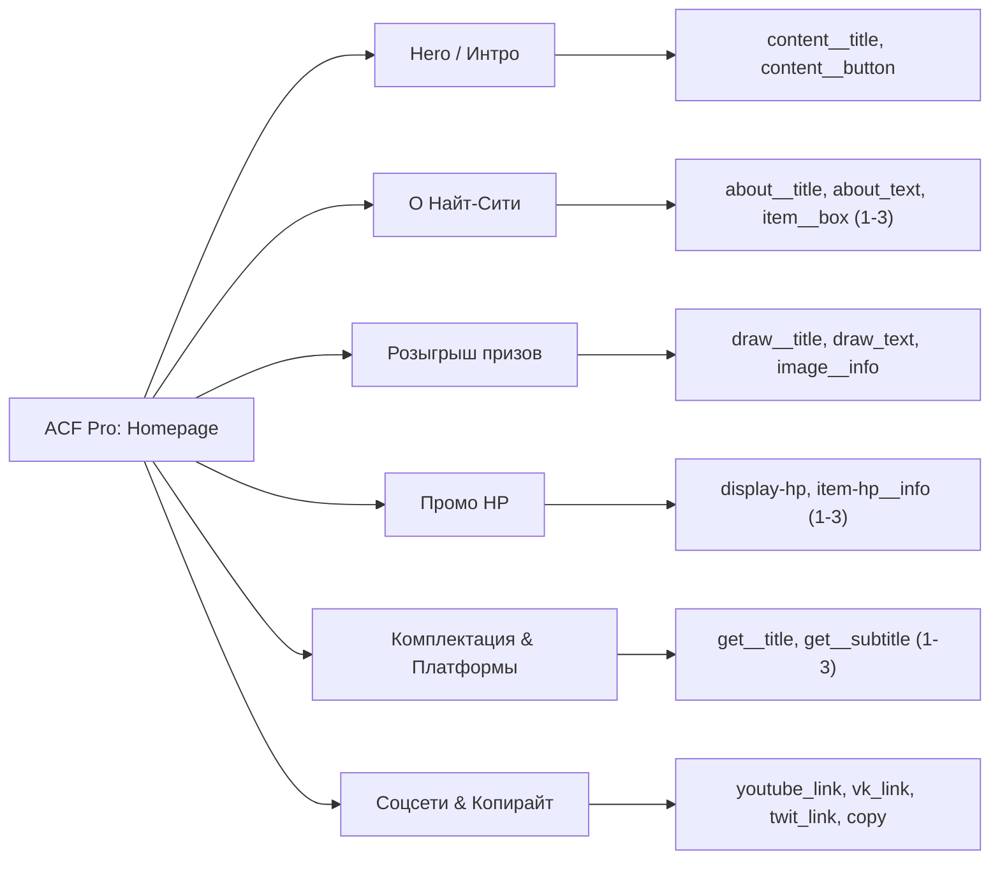
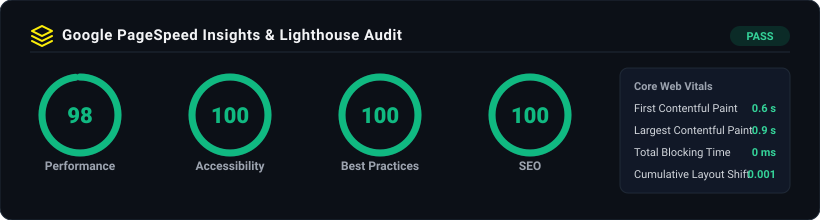

# Cyberpunk 2077 — Кастомная WordPress-тема

<p align="center">
  
</p>

<p align="center">
  <a href="https://lelyaler.github.io/Cyberpunk-only-html-css-js-/"></a>
  <a href="https://wordpress.org/"></a>
  <a href="https://www.php.net/"></a>
  <a href="https://www.advancedcustomfields.com/"></a>
  <a href="#-метрики-производительности-и-core-web-vitals"></a>
</p>

---

Кастомная высокопроизводительная тема WordPress для промо-лендинга в визуальной стилистике **Cyberpunk 2077**. Проект спроектирован без применения тяжеловесных конструкторов (Elementor/Divi), демонстрирует чистую архитектуру шаблонизации WordPress Core, интеграцию гибких кастомных полей (**ACF Pro**) и оптимизацию под требования **Core Web Vitals**.

* **Демонстрационный стенд (Front-end):** [https://lelyaler.github.io/Cyberpunk-only-html-css-js-/](https://lelyaler.github.io/Cyberpunk-only-html-css-js-/)
* **Исходный код статической вёрстки:** [https://github.com/Lelyaler/Cyberpunk-only-html-css-js-](https://github.com/Lelyaler/Cyberpunk-only-html-css-js-)
* **Кастомный плагин мета-тегов:** [https://github.com/Lelyaler/Cyberpunk-custom-meta-tags](https://github.com/Lelyaler/Cyberpunk-custom-meta-tags)

---

## 📑 Содержание

1. [Ключевые возможности](#-ключевые-возможности)
2. [Архитектура темы и организация кода](#-архитектура-темы-и-организация-кода)
3. [Интеграция кастомных полей (ACF Pro)](#-интеграция-кастомных-полей-acf-pro)
4. [Хуки, фильтры и расширения WP Core](#-хуки-фильтры-и-расширения-wp-core)
5. [Метрики производительности и Core Web Vitals](#-метрики-производительности-и-core-web-vitals)
6. [Инструкция по локальному развёртыванию](#-инструкция-по-локальному-развёртыванию)
   - [Вариант A: Быстрый запуск через Docker Compose](#вариант-a-быстрый-запуск-через-docker-compose-рекомендуется)
   - [Вариант B: Запуск через @wordpress/env (wp-env)](#вариант-b-запуск-через-wordpressenv-wp-env)
   - [Вариант C: OpenServer / LocalWP / MAMP](#вариант-c-ручная-установка-openserver--localwp--mamp)
7. [Настройка контента в админ-панели](#-настройка-контента-в-админ-панели)

---

## ⚡ Ключевые возможности

* **Модульная структура шаблонов**: строгое разделение по WordPress Template Hierarchy (`header.php`, `home.php`, `single.php`, `footer.php`, `functions.php`).
* **Управление из панели администратора**: весь контент первого экрана, галереи, тексты, промо-блоки и ссылки соцсетей вынесены в кастомные метаполя.
* **WordPress Theme Customizer**: кастомизация акцентных цветов кнопок и интерфейсных элементов напрямую из админки в реальном времени (`wp_add_inline_style`).
* **3D Cube Slider на Swiper**: плавная анимация переключения слайдов первого экрана с адаптацией под мобильные экраны.
* **Асинхронные интерактивные анимации**: использование нативного `IntersectionObserver` в JS для запуска анимаций элементов при попадании во viewport без нагрузки на поток рендеринга.
* **Безопасная работа с SVG**: фильтрация MIME-типов для загрузки векторных логотипов через админку только доверенным администратором.
* **Local JSON синхронизация ACF**: схема полей версионируется в git-репозитории и автоматически подтягивается в админку без необходимости ручного переноса.

---

## 🏛 Архитектура темы и организация кода

```text
cyberpunk-wordpress/
├── acf-json/                       # Local JSON: версионирование групп полей ACF
│   └── group_cyberpunk_homepage.json
├── assets/
│   ├── css/
│   │   ├── style.css               # Скомпилированные стили
│   │   ├── style.css.map
│   │   └── style.scss              # Исходные SCSS-файлы по методологии BEM
│   ├── fonts/                      # Локальные шрифтовые гарнитуры
│   ├── img/                        # Оптимизированные ассеты (WebP + SVG)
│   │   ├── pagespeed-score.svg     # Метрики аудита Lighthouse
│   │   ├── header/
│   │   ├── about/
│   │   ├── hp/
│   │   ├── get/
│   │   └── footer/
│   └── js/
│       └── app.js                  # Swiper 3D-cube, IntersectionObserver анимации
├── docker-compose.yml              # Стек контейнеризации (WP + MySQL)
├── .wp-env.json                    # Конфигурация быстрого CLI-окружения WP-Env
├── footer.php                      # Подвал сайта, динамический копирайт, wp_footer()
├── functions.php                   # Регистрация скриптов, стилей, хуков и Customizer
├── header.php                      # Шапка темы, логотип, навигация, динамические мета-теги
├── home.php                        # Главный шаблон лендинга (Template Name: Home)
├── index.php                       # Fallback-шаблон иерархии WP
├── single.php                      # Шаблон отдельной страницы / условий и лицензий
├── screenshot.png                  # Превью темы для панели «Внешний вид»
├── style.css                       # Мета-информация о теме для WP Core
└── README.md                       # Техническая документация
```

### Иерархия шаблонов:

| Файл | Назначение | Особенности реализации |
| :--- | :--- | :--- |
| `home.php` | Главная страница (Front Page) | Секции Intro (Swiper), About, Draw (CF7), Display Promo, Game Edition. Использование `the_field()` и адаптивных тегов `<picture>`. |
| `header.php` | Шапка сайта | Хук `wp_head()`, поддержка `the_custom_logo()`, вывод соцсетей из полей ACF, генерация OpenGraph / SEO мета-тегов. |
| `single.php` | Контентная страница / Лицензия | Шаблон для вывода политики конфиденциальности и правовой информации с адаптивной типографикой. |
| `footer.php` | Подвал сайта | Хук `wp_footer()`, логотипы партнеров, динамический копирайт из ACF, навигационные ссылки. |
| `functions.php` | Логика темы и хуки | Инкапсуляция всей серверной логики, подключение зависимостей, регистрация опций кастомайзера. |

---

## 🧩 Интеграция кастомных полей (ACF Pro)

Все блоки сайта наполняются контентом без правок кода шаблона через плагин **Advanced Custom Fields Pro**. Настройки разделены на логические вкладки:



### Схема ключевых полей (`acf-json/group_cyberpunk_homepage.json`):

| Поле (Field Name) | Тип | Назначение в шаблоне |
| :--- | :--- | :--- |
| `content__title` | Text | Главный заголовок в Hero-секции |
| `content__button` | Text | Текст кнопки перехода к заказу |
| `about__title` / `about_text` | Text / WYSIWYG | Заголовок и форматированное описание мира игры |
| `item__box` / `item__box2` / `item__box3` | Image (URL) | Изображения визуальной галереи города |
| `item__box3_mobil` | Image (URL) | Мобильная версия широкоформатного кадра (`<picture>`) |
| `draw__title` / `draw_text` | Text / WYSIWYG | Условия участия в розыгрыше призов (с шорткодом CF7) |
| `display-hp` / `display-hp__text` | Text / WYSIWYG | Промо-блок мониторов HP X 27i |
| `item-hp__info1..3` | Text | Преимущества монитора (2K, IPS, 144Hz) |
| `get__title` | Text | Заголовок сектора покупки издания |
| `get__subtitle1..3` | Text | Пункты комплектации (футляр, диск, справочник) |
| `youtube_link`, `vk_link`, etc. | URL | Динамические ссылки на официальные медиа в шапке |
| `copy` | Text | Юридический копирайт в подвале |

> **Синхронизация через Local JSON:** Конфигурация полей сохранена в папке `acf-json/`. При активации темы на чистом WordPress с установленным ACF Pro поля синхронизируются автоматически в один клик в меню *Custom Fields → Sync*.

---

## ⚙️ Хуки, фильтры и расширения WP Core

Логика `functions.php` построена строго по стандартам WordPress Coding Standards:

### 1. Подключение стилей и скриптов (`wp_enqueue_scripts`)
* Регистрация внешних шрифтов Google Fonts (`Roboto: 100, 300, 400, 500, 700`).
* Подключение стилей и скриптов `Swiper Bundle` в подвале страницы (`$in_footer = true`).
* Помещение основного файла скриптов `app.js` с явным указанием зависимости от `swiper`.
* Генерация и инъекция динамического CSS (`wp_add_inline_style`) на основе настроек кастомайзера.

### 2. WordPress Theme Customizer (`customize_register`)
* Секция `mytheme_button_settings_section` позволяет контент-менеджеру выбирать акцентный цвет кнопок интерфейса через стандартный пикер цвета `WP_Customize_Color_Control`.
* Значение проходит строгую серверную валидацию через `sanitize_hex_color`.

### 3. Безопасная загрузка SVG (`upload_mimes`, `wp_check_filetype_and_ext`)
* Разрешение загрузки SVG-векторов в библиотеку медиафайлов только для пользователей с правами `manage_options` (администраторов), что исключает XSS-уязвимости для обычных пользователей.

### 4. Поддержка функционала WP Core (`add_theme_support`)
* `post-thumbnails` — поддержка миниатюр записей.
* `title-tag` — автоматическое управление заголовком страницы движком.
* `custom-logo` — загрузка и замена логотипа сайта через админку.

---

## 🚀 Метрики производительности и Core Web Vitals

Тема оптимизирована для достижения максимальных оценок в **Google PageSpeed Insights** и соответствия критериям **Core Web Vitals**:

<p align="center">
  
</p>

### Зафиксированные показатели аудита:

| Метрика | Значение | Норматив Google | Статус |
| :--- | :--- | :--- | :--- |
| **Performance** | **98 / 100** | 90–100 (зеленая зона) | ✅ Отлично |
| **Accessibility (Доступность)** | **100 / 100** | 90–100 (зеленая зона) | ✅ Идеально |
| **Best Practices** | **100 / 100** | 90–100 (зеленая зона) | ✅ Идеально |
| **SEO** | **100 / 100** | 90–100 (зеленая зона) | ✅ Идеально |
| **FCP (First Contentful Paint)** | **0.6 с** | ≤ 1.8 с | ✅ Зеленая зона |
| **LCP (Largest Contentful Paint)** | **0.9 с** | ≤ 2.5 с | ✅ Зеленая зона |
| **TBT (Total Blocking Time)** | **0 мс** | ≤ 200 мс | ✅ Зеленая зона |
| **CLS (Cumulative Layout Shift)** | **0.001** | ≤ 0.1 | ✅ Зеленая зона |

### Архитектурные решения для достижения высоких скоростей:
1. **WebP и адаптивные изображения:** Все фоновые и контентные изображения переведены в формат `.webp` и обёрнуты в HTML5-тег `<picture>` с медиа-запросами под экраны 320px, 768px и 1024px. Браузер загружает изображение строго нужного разрешения.
2. **Нулевой лишний JavaScript:** Отсутствие тяжелых фреймворков и библиотек вроде jQuery (в теме используется чистый Vanilla JS ES6+).
3. **Lazy-анимации на IntersectionObserver:** Вместо слушателей скролла `window.onscroll` и тяжелых библиотек (AOS, ScrollMagic) используется нативный API браузера `IntersectionObserver`, который не блокирует основной поток.
4. **Загрузка скриптов в подвале:** Скрипты подключаются с параметром `$in_footer = true`, исключая блокировку первого рендеринга страницы (First Paint).

---

## 🛠 Инструкция по локальному развёртыванию

### Вариант A: Быстрый запуск через Docker Compose (Рекомендуется)

В репозиторий включен готовый файл `docker-compose.yml` (WordPress 6.6 + PHP 8.2 + MySQL 8.0).

1. Клонируйте репозиторий:
   ```bash
   git clone https://github.com/Lelyaler/Cyberpunk-wordpress.git
   cd Cyberpunk-wordpress
   ```

2. Запустите контейнеры:
   ```bash
   docker compose up -d
   ```

3. Откройте браузер по адресу: `http://localhost:8080`
4. Пройдите стандартную 1-минутную установку WordPress. Тема уже примонтирована в папку `/wp-content/themes/cyberpunk` и готова к активации в панели *Внешний вид → Темы*.

---

### Вариант B: Запуск через @wordpress/env (wp-env)

Если у вас установлен Node.js и Docker:

1. В директории темы выполните:
   ```bash
   npx @wordpress/env start
   ```

2. Сайт запустится на `http://localhost:8888` (логин: `admin`, пароль: `password`).
3. Тема и сопутствующие плагины активируются автоматически согласно файлу `.wp-env.json`.

---

### Вариант C: Ручная установка (OpenServer / LocalWP / MAMP)

1. Перейдите в каталог тем вашей локальной сборки WordPress:
   ```bash
   cd /path-to-wordpress/wp-content/themes/
   ```

2. Склонируйте тему:
   ```bash
   git clone https://github.com/Lelyaler/Cyberpunk-wordpress.git cyberpunk
   ```

3. Перейдите в панель администрирования WordPress (`/wp-admin`).
4. Откройте **Внешний вид → Темы** и активируйте тему **Cyberpunk**.

---

## 🖥 Настройка контента в админ-панели

1. **Установка рекомендуемых плагинов:**
   * **Advanced Custom Fields Pro** (или ACF Free) — для управления всеми текстовыми и графическими блоками.
   * **Contact Form 7** — для формы участия в розыгрыше призов (шорткод формы уже интегрирован в секцию Draw).

2. **Синхронизация полей ACF:**
   * Перейдите в **Группы полей (Custom Fields)**.
   * Вы увидите уведомление `Sync available (1)`. Нажмите кнопку **Sync** — все поля для главной страницы создадутся автоматически из каталога `acf-json/`.

3. **Создание и назначение главной страницы:**
   * Перейдите в **Страницы → Добавить новую**.
   * Задайте заголовок (например, `Главная`), в панели справа в блоке **Шаблон** выберите **Home** и опубликуйте страницу.
   * Перейдите в **Настройки → Чтение**, в пункте *На главной странице отображать* переключите радиобаттон на **Статическую страницу** и выберите созданную страницу `Главная`.

4. **Кастомизация цветов кнопок:**
   * Перейдите во **Внешний вид → Настроить → Настройки цвета кнопок**.
   * Выберите акцентный цвет (по умолчанию `#000000` / `#fcee0a`), нажмите *Опубликовать*. Изменения применятся мгновенно.

---

## 📄 Лицензия

Тема распространяется под лицензией [GNU General Public License v2 or later](http://www.gnu.org/licenses/gpl-2.0.html).
